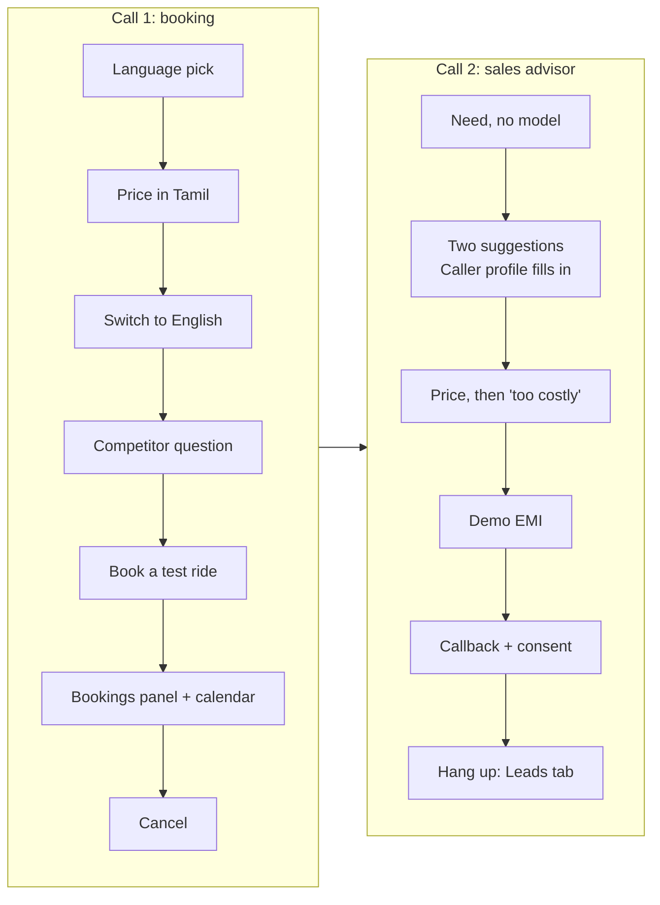

# Demo script (about 7 minutes)

Two calls:
- **Call 1, booking (about 4 minutes):** language choice and switching, prices from the catalog, the competitor policy, a test-ride booking with the licence question and the read-back, the live Bookings panel and calendar, and a cancellation.
- **Call 2, sales advisor (about 3 minutes):** finding a bike for a need, the live Caller profile card, a demo EMI, and a callback with consent that becomes a scored lead in the Leads tab.

Both are re-proven by the pre-demo check: call 1 is `evals/scenarios/demo.yaml` (verified 2026-10-16), and call 2's steps are scenarios in `evals/scenarios/advisor.yaml` (verified 2026-10-20). The [use-case list](#use-cases-you-can-demonstrate) below has lines for everything else the agent can do.

## Before the audience arrives (5 minutes)

1. `make check` → all **PASS** (or at least `make check-quick` if short on time).
2. `uv run python scripts/generate_slots.py --days 14` (keeps tomorrow's slots available).
3. Start the agent: `uv run python -m honda_voice.agent.worker dev`; wait for `registered worker`. Check `.env` has `ADVISOR=on` and `NOISE_CANCELLATION=bvc`.
4. Start the website: `cd frontend && corepack pnpm@9.15.9 dev`; open http://localhost:3000 and sign in.
5. Open the Google Calendar "Honda Demo – Test Rides" in a second tab.
6. Use a headset or a quiet room; speak at a normal pace and pause briefly after each sentence.

## Call 1: booking

| # | You say | What the agent does | Point out |
|---|---|---|---|
| 0 | (press **Start call**) | Greets in Tamil and asks which language you'd like | Fixed greeting, no waiting for the AI |
| 1 | "Tamil" (or "தமிழ்") | Says it can help find the right Honda, answer model and price questions, and book or cancel a test ride, in Tamil | Played straight from code: no AI call, so it's instant |
| 2 | "Activa 125 விலை என்ன?" | Ex-showroom price range in Tamil | Prices are read from the catalog, never invented by the AI |
| 3 | "Can you tell me in English, what is the mileage of the Shine 100?" | Switches to English; gives the mileage | Language switches only on a clear request or a full sentence, never on "ok" |
| 4 | "Is the TVS Jupiter better than the Activa?" | Says nothing about the Jupiter; offers a Honda fact | Competitor policy: no claims about other brands |
| 5 | "I'd like to book a test ride for the Activa 125 tomorrow at 4 pm" | Confirms 4 pm is free; asks about a driving licence | Hands over to the booking agent; slot checked in the database |
| 6 | "Yes, I have a driving licence" | Asks your name | A ride can't be booked without a licence |
| 7 | "My name is …" | Asks for your mobile number | |
| 8 | Your mobile number, digit by digit | Reads back model, slot, name, number in 5 + 5 digits, licence; asks to confirm | One read-back built by code; nothing is booked yet |
| 9 | "Yes, please confirm" | Books it; spells the booking code "H N D, …"; reminds you to bring the licence | **Show the Bookings panel** (updates within 5 s, name and number masked) and **the calendar** (event within ~2 s) |
| 10 | "I'd like to cancel that booking" | Asks for the code and number | |
| 11 | The code (letter by letter), then the number | Cancels it | The panel shows *Cancelled*; the calendar event disappears |

## Call 2: sales advisor

Press the red button to end call 1, then **Start call** again. Keep the side panel open: the **Caller profile** card appears during the call.

| # | You say | What the agent does | Point out |
|---|---|---|---|
| 0 | (press **Start call**), then "English" | Greets, then the intro | |
| 1 | "I'm looking for a scooter for my mother, she's in her late forties. It should be easy to handle with good mileage." | Suggests two scooters (e.g. Activa, Dio) with one reason each | The bikes are ranked by code from fit data, not picked by the AI. **Watch the Caller profile card**: rider *parent*, priorities *ease, mileage*. It's filled by a second, smaller model in the background, so the reply isn't slowed |
| 2 | "What's the price of the Activa 125?" | Ex-showroom price range | |
| 3 | "That's too costly for me. Can I pay in EMI?" | One demo EMI example, "example only; the showroom confirms the actual terms" | EMI is computed in code from the catalog price and demo schemes. The profile now shows the price objection and EMI interest |
| 4 | "Can someone from the showroom call me about EMI offers?" | Asks your name and number | |
| 5 | Your name and mobile number | Reads the number back in 5 + 5 digits and asks if the showroom may call you about this | Consent is asked before anything is saved; the line comes straight from code |
| 6 | "Yes, you can call me" | Confirms the callback | Saved with the consent, its time and wording version |
| 7 | (end the call), then open the **Leads** tab | | The lead appears within about 10 s (the summary is written after the call): score and band (hot/warm/cold), a 2–3 sentence summary with no name or number, the next action ("Share current EMI and offers for Honda Activa 125"), masked number. **Download CSV** |

## Use cases you can demonstrate

Each line is taken from a scripted conversation that passes in the pre-demo check (file in the last column, under `evals/scenarios/`). Any of the six languages works; the examples mix them on purpose.

| # | Use case | Say | Expect | Scenario |
|---|---|---|---|---|
| U1 | Choose or switch language | "தமிழ்"; later "Hindi mein baat kariye please" or "Telugu lo cheppandi, Shine 100 price entha?" | Replies switch to that language; "ok" doesn't switch | `language.yaml` |
| U2 | Price and specs | "Activa 125 விலை என்ன?"; "What is the ground clearance of the Activa 125?" | Ex-showroom range, Delhi on-road with breakdown, one spec | `price.yaml`, `misc.yaml` |
| U3 | Budget list | "Ek lakh ke andar koi scooter batao" | Up to 4 scooters, cheapest first | `misc.yaml` |
| U4 | Compare two Hondas | "Compare the Unicorn and the SP160 for me"; "Activa 125 aur Dio 125 mein kya fark hai?" | Side by side: engine, mileage, price | `compare.yaml` |
| U5 | Competitor question | "Is the TVS Jupiter better than the Activa?" | No claim about the other brand; a Honda strength | `competitor.yaml` |
| U6 | Bike for a need | "Main roz office tees kilometre jaata hoon, budget lagbhag nabbe hazaar hai, kaunsi bike lun?" | Two commuter suggestions within budget, with reasons | `advisor.yaml` |
| U7 | Electric for delivery (Tamil) | "நான் food delivery பண்றேன், petrol செலவு ரொம்ப அதிகம், electric scooter ஏதாவது இருக்கா?" | Honda electric scooters (e.g. QC1, Activa e:) | `advisor.yaml` |
| U8 | Price objection and EMI | "That's too costly for me. Can I pay in EMI?" | A demo EMI, called an example | `advisor.yaml` |
| U9 | Showroom hours | "Is the showroom open tomorrow at 6 pm?" | Open or closed, with the times | `misc.yaml` |
| U10 | Book a test ride (Hinglish time words) | "Kal shaam saade chaar baje Dio 125 ki test ride chahiye" | 16:30 slot, licence, read-back, booking code | `booking.yaml`, `slot_taken.yaml` |
| U11 | Slot taken | Book a slot someone else just took | The 2 nearest free times; a new read-back | `slot_taken.yaml` |
| U12 | Misheard number | "No, that's wrong", then the number again | New read-back before booking | `phone.yaml` |
| U13 | Cancel a booking | "Cancel my booking", then the code and number | Cancelled; calendar event removed | `cancel.yaml` |
| U14 | No licence | "Can I book a test ride for the Shine 100 tomorrow at 12?" → "No, I don't have a licence yet" | No booking; callback with consent instead | `misc.yaml` |
| U15 | Model not on sale | "I want to book a test ride for the XR300L" | Pre-booking model: callback offered, no booking | `misc.yaml` |
| U16 | Callback with consent | "Can someone from the showroom call me about the Unicorn?" + name and number + "yes" (or "no, don't call me") | Lead and customer saved on yes; nothing on no | `advisor.yaml` |
| U17 | Ready buyer | "Shine 100 ki price kya hai?" → "Achha, mujhe isi hafte lena hai." | Offers a test ride | `advisor.yaml` |
| U18 | Just browsing | "Just checking for now, maybe I'll buy next year." | Answers; no test-ride push | `advisor.yaml` |
| U19 | Frustrated caller | "This is useless, I want to talk to a real person!" | No more questions; callback offer | `advisor.yaml` |
| U20 | Out of scope | "I need to renew my bike insurance"; "Meri Activa ki servicing kab karwani chahiye?" | Polite line and a callback offer | `out_of_scope.yaml` |
| U21 | Question mid-booking | During a booking: "Actually, what's the ex-showroom price of the NX200 first?" | Answers, then continues the booking | `misc.yaml` |
| U22 | Background voices | Have someone talk in the background | Not transcribed; the language doesn't change (`NOISE_CANCELLATION=bvc`) | Live only |

After any call, the **Leads** tab shows its leads with a score and summary, and `uv run python scripts/latency_report.py --last 1` shows the response times.

## If something goes wrong

| What happens | What to do |
|---|---|
| A short pause, then "One moment please, let me check." | Normal on a slow turn: the reply follows once the line finishes. |
| The agent answers in the wrong language | Say "please speak in English" (or the language you want). |
| It mishears the phone number | Say "no, that's wrong", then the number again, digit by digit; it reads it back again before booking. |
| The slot is taken | It offers the nearest free times; pick one, then confirm the new read-back. |
| The Caller profile card stays empty | The profile appears after the first caller turn's signals (~1–2 s). If it never fills, check `ADVISOR` in `.env` and `advisor:` warnings in `logs/worker.log`; the call itself is unaffected. |
| The lead isn't in the Leads tab | Leads are scored when the call ends: hang up, wait a few seconds, and reopen the tab. No lead is saved if the caller didn't say yes to the consent read-back. |
| No reply at all for more than ~10 s | Press the red end-call button and start a new call. Afterwards, check `logs/worker.log` for that room. |

## After the demo

- Response times from the calls: `uv run python scripts/latency_report.py --last 2`.
- Leads from the demo: **Download CSV** in the Leads tab if you want to keep them.
- Rotate `DEMO_PASSCODE` in `frontend/.env.local` if it was shown to the audience.
