# Architecture: Honda 2-Wheeler Multilingual Voice Agent (POC)

A caller talks to a voice agent in the browser, in Tamil, English, Hindi (Hinglish), Telugu, Malayalam or Kannada. The agent answers questions about Honda two-wheelers, suggests models for the caller's needs, gives demo EMI examples, checks showroom hours, books or cancels test rides, and records callback requests as scored leads. This document describes what runs where, which models are used, and how a call flows through the system. Detailed decisions, measurements and history are in [SPEC.md](SPEC.md); this file is the overview.

Diagrams are written in [Mermaid](https://mermaid.js.org), which GitHub, GitLab and VS Code (with a Mermaid preview extension) draw directly from the text. Diagrams 1–5 and 12 also have a draw.io version, drawn for Phases 0–6, in [`diagrams/`](diagrams/) (open with [diagrams.net](https://app.diagrams.net), File → Open). Where they differ, the Mermaid diagram is current.

Status (2026-10-21): Phases 0–7 built (Phase 6 waits on four live demo runs, Phase 7 on a live check of its latency). Phase 8 (LangGraph) and Phases 10–11 (self-hosted LiveKit and Postgres) are planned.

---

## Use cases

What the demo can show today. [DEMO.md](DEMO.md) has the lines to say for each, and the scripted conversations in `evals/scenarios/` prove them before every demo.

| # | Use case | What the caller does | What the system shows | Built from |
|---|---|---|---|---|
| U1 | **Choose a language** | Picks one of six languages, or switches mid-call ("Hindi mein baat karo") | Replies in that language; "ok" never flips it; a background voice doesn't either | Language rule (code), BVC filter |
| U2 | **Model, price and spec questions** | "Activa 125 விலை என்ன?", "mileage of the Shine 100?" | Ex-showroom range, Delhi on-road breakdown, mileage, colours, features | `find_bike`, catalog, price formatter |
| U3 | **List by budget or segment** | "Scooters under 90,000?" | Up to 4 models, cheapest first | `list_bikes` |
| U4 | **Compare two Hondas** | "Compare the Unicorn and the SP160" | Side-by-side engine, mileage, price | `compare_bikes` |
| U5 | **Competitor question** | "Is the TVS Jupiter better than the Activa?" | No claim about the other brand; a Honda strength instead | Competitor pivot (code) |
| U6 | **Find the right bike for a need** | "Scooter for my mother, easy to handle, good mileage" | Two suggestions with one reason each; the Caller profile card fills in | `recommend_bikes`, nano signals |
| U7 | **Price objection and EMI** | "Too costly. Can I pay in EMI?" | A demo EMI from code, "example only" | `emi_examples`, advisor move |
| U8 | **Showroom hours** | "Open on Sunday at 6 pm?" | Opening times for that day | `check_showroom_open` |
| U9 | **Book a test ride** | "Test ride of the Activa 125 tomorrow at 4 pm" | Slot check, licence question, one read-back, booking code; Bookings panel and calendar update | BookingAgent, booking guard, `reserve_slot` |
| U10 | **Slot taken, or a correction** | Picks a busy slot, or "no, the number is wrong" | Two nearest free times, or a new read-back | Slot search, guard |
| U11 | **Cancel a booking** | Gives the code and the number | Cancelled; the calendar event is removed | `cancel_test_ride` |
| U12 | **No licence, or a model not on sale** | "I don't have a licence", or asks for the XR300L | No booking; a callback is offered instead | Guard, `capture_lead` |
| U13 | **Callback with consent** | "Can the showroom call me?" + name, number, "yes" | Number read back; consent stored; a scored lead with a summary in the Leads tab; CSV export | `capture_lead`, `customers`, lead score |
| U14 | **Browsing or frustrated caller** | "Just looking", or "I want a real person" | No pushing; or a callback offer with no more questions | Advisor moves |
| U15 | **Out of scope** | "When should my Activa be serviced?" | A polite line and a callback offer | Scope rule (code) |
| U16 | **Slow turn** | Any question that takes more than 2 s | "One moment please, let me check." finishes, then the reply | Hold line |

---

## 1. Components and where they run

| Component | Where it runs | What it does |
|---|---|---|
| **Browser app** | Caller's device | Next.js page built from LiveKit's `agent-starter-react` template: passcode screen and privacy notice, call controls, live transcript, and a side panel with **Bookings**, **Models** and **Leads** tabs plus a live **Caller profile** card during a call. Talks to the Next.js server over HTTPS and to LiveKit Cloud over WebRTC. |
| **Next.js server** | Developer machine (`frontend/`) | Sign-in (`/api/login`), call tokens (`/api/token`), read-only data for the panels (`/api/bookings`, `/api/catalog`, `/api/leads`, `/api/leads/export` (CSV), `/api/profile?room=`). Holds the LiveKit API secret and the read-only database password; neither reaches the browser. |
| **Agent worker** | Developer machine (`src/honda_voice/`, Python 3.11, LiveKit Agents 1.8.8) | The voice agent itself: one process per call, running the speech pipeline (with the BVC background-voice filter), the two agents (Sales, Booking), their tools, the booking guard, the hold line, the **sales advisor** (caller signals, suggested moves, end-of-call summary and lead score) and the metrics. Connects out to LiveKit Cloud, Sarvam, Azure, Supabase and Google. |
| **LiveKit Cloud** | LiveKit's hosted service | Media server (relays the caller's and agent's audio), signalling, NAT traversal (TURN), agent dispatch (sends each new call to a free worker), two hosted ML models used in the turn-taking (§3), and the licence for the BVC voice-isolation filter. |
| **Sarvam AI** | Sarvam's API | Speech-to-text (streaming) and text-to-speech for all six languages. |
| **Azure OpenAI** | Azure, South India region | `gpt-5.4-mini` decides what to say and which tool to call; `gpt-5.4-nano` reads caller signals in the background, writes the after-call summary, and is the fallback LLM. |
| **Supabase Postgres** | Supabase, Mumbai (ap-south-1) | Source of truth: catalog (with fit tags and demo finance schemes), showroom hours, test-ride slots, bookings, calls, caller profiles, leads and the customer list. |
| **Google Calendar** | Google | Write-only copy of bookings for showroom staff (masked phone). A failure here never affects a booking. |
| **Laya** (optional) | Developer machine GPU, `127.0.0.1:8100` | Optional signal provider (`SIGNAL_PROVIDER=laya`); replaced by gpt-5.4-nano for caller understanding (SPEC §23.2b). Off by default. |

### Diagram 1: System context

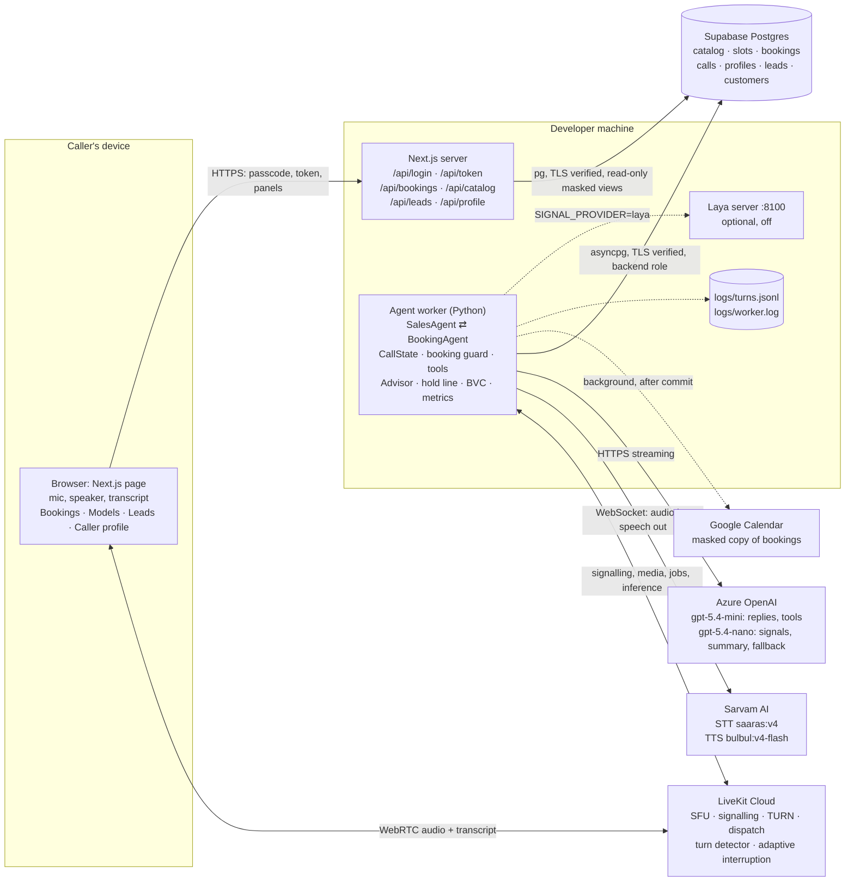

<details>
<summary>draw.io XML (<code>diagrams/01-system-context.drawio</code>)</summary>

```xml
<mxfile host="app.diagrams.net">
  <diagram id="01 System context" name="01 System context">
    <mxGraphModel dx="1400" dy="900" grid="1" gridSize="10" guides="1" page="1" pageWidth="1600" pageHeight="1100">
      <root>
        <mxCell id="0" />
        <mxCell id="1" parent="0" />
        <mxCell id="g_user" value="Caller's device" style="rounded=1;whiteSpace=wrap;html=1;fillColor=none;strokeColor=#999999;dashed=1;verticalAlign=top;align=left;spacingLeft=8;fontStyle=1;" vertex="1" parent="1">
          <mxGeometry x="20" y="20" width="260" height="160" as="geometry" />
        </mxCell>
        <mxCell id="browser" value="Browser&lt;br&gt;Next.js page (React, livekit-client)&lt;br&gt;mic + speaker, transcript, panels" style="rounded=1;whiteSpace=wrap;html=1;fillColor=#dae8fc;strokeColor=#6c8ebf;" vertex="1" parent="1">
          <mxGeometry x="40" y="60" width="220" height="100" as="geometry" />
        </mxCell>
        <mxCell id="g_dev" value="Developer machine (Phases 1-9)" style="rounded=1;whiteSpace=wrap;html=1;fillColor=none;strokeColor=#999999;dashed=1;verticalAlign=top;align=left;spacingLeft=8;fontStyle=1;" vertex="1" parent="1">
          <mxGeometry x="20" y="220" width="600" height="470" as="geometry" />
        </mxCell>
        <mxCell id="next" value="Next.js server&lt;br&gt;/api/login /api/token&lt;br&gt;/api/bookings /api/catalog" style="rounded=1;whiteSpace=wrap;html=1;fillColor=#d5e8d4;strokeColor=#82b366;" vertex="1" parent="1">
          <mxGeometry x="40" y="260" width="220" height="90" as="geometry" />
        </mxCell>
        <mxCell id="worker" value="Agent worker (Python, LiveKit Agents 1.8.8)&lt;br&gt;SalesAgent / BookingAgent, CallState,&lt;br&gt;booking guard, hold audio, metrics" style="rounded=1;whiteSpace=wrap;html=1;fillColor=#d5e8d4;strokeColor=#82b366;" vertex="1" parent="1">
          <mxGeometry x="300" y="260" width="300" height="110" as="geometry" />
        </mxCell>
        <mxCell id="logs" value="logs/turns.jsonl&lt;br&gt;logs/worker.log" style="rounded=1;whiteSpace=wrap;html=1;fillColor=#f5f5f5;strokeColor=#666666;dashed=1;" vertex="1" parent="1">
          <mxGeometry x="300" y="410" width="140" height="60" as="geometry" />
        </mxCell>
        <mxCell id="laya" value="Laya decision server&lt;br&gt;127.0.0.1:8100 (Phase 7, off)" style="rounded=1;whiteSpace=wrap;html=1;fillColor=#f5f5f5;strokeColor=#666666;dashed=1;" vertex="1" parent="1">
          <mxGeometry x="460" y="410" width="140" height="60" as="geometry" />
        </mxCell>
        <mxCell id="lk" value="LiveKit Cloud&lt;br&gt;SFU + signalling + TURN&lt;br&gt;agent dispatch&lt;br&gt;inference: turn detector,&lt;br&gt;adaptive interruption" style="rounded=1;whiteSpace=wrap;html=1;fillColor=#fff2cc;strokeColor=#d6b656;" vertex="1" parent="1">
          <mxGeometry x="700" y="20" width="260" height="140" as="geometry" />
        </mxCell>
        <mxCell id="sarvam" value="Sarvam AI&lt;br&gt;STT saaras:v4 (codemix)&lt;br&gt;TTS bulbul:v4-flash" style="rounded=1;whiteSpace=wrap;html=1;fillColor=#e1d5e7;strokeColor=#9673a6;" vertex="1" parent="1">
          <mxGeometry x="700" y="220" width="260" height="80" as="geometry" />
        </mxCell>
        <mxCell id="azure" value="Azure OpenAI (South India)&lt;br&gt;gpt-5.4-mini&lt;br&gt;+ optional fallback deployment" style="rounded=1;whiteSpace=wrap;html=1;fillColor=#e1d5e7;strokeColor=#9673a6;" vertex="1" parent="1">
          <mxGeometry x="700" y="330" width="260" height="80" as="geometry" />
        </mxCell>
        <mxCell id="db" value="Supabase Postgres (Mumbai)&lt;br&gt;catalog, slots, bookings, leads" style="shape=cylinder3;whiteSpace=wrap;html=1;boundedLbl=1;size=12;fillColor=#f8cecc;strokeColor=#b85450;" vertex="1" parent="1">
          <mxGeometry x="700" y="450" width="260" height="90" as="geometry" />
        </mxCell>
        <mxCell id="gcal" value="Google Calendar&lt;br&gt;Honda Demo - Test Rides" style="rounded=1;whiteSpace=wrap;html=1;fillColor=#fff2cc;strokeColor=#d6b656;" vertex="1" parent="1">
          <mxGeometry x="700" y="580" width="260" height="60" as="geometry" />
        </mxCell>
        <mxCell id="e0" value="HTTPS: passcode, token, panels" style="edgeStyle=orthogonalEdgeStyle;rounded=1;html=1;endArrow=block;endFill=1;fontSize=10;" edge="1" parent="1" source="browser" target="next">
          <mxGeometry relative="1" as="geometry" />
        </mxCell>
        <mxCell id="e1" value="WebRTC audio (DTLS-SRTP) + transcript" style="edgeStyle=orthogonalEdgeStyle;rounded=1;html=1;endArrow=block;endFill=1;fontSize=10;" edge="1" parent="1" source="browser" target="lk">
          <mxGeometry relative="1" as="geometry" />
        </mxCell>
        <mxCell id="e2" value="WebSocket signalling + WebRTC; jobs; inference" style="edgeStyle=orthogonalEdgeStyle;rounded=1;html=1;endArrow=block;endFill=1;fontSize=10;" edge="1" parent="1" source="worker" target="lk">
          <mxGeometry relative="1" as="geometry" />
        </mxCell>
        <mxCell id="e3" value="WebSocket: audio in, speech out" style="edgeStyle=orthogonalEdgeStyle;rounded=1;html=1;endArrow=block;endFill=1;fontSize=10;" edge="1" parent="1" source="worker" target="sarvam">
          <mxGeometry relative="1" as="geometry" />
        </mxCell>
        <mxCell id="e4" value="HTTPS streaming chat completions" style="edgeStyle=orthogonalEdgeStyle;rounded=1;html=1;endArrow=block;endFill=1;fontSize=10;" edge="1" parent="1" source="worker" target="azure">
          <mxGeometry relative="1" as="geometry" />
        </mxCell>
        <mxCell id="e5" value="asyncpg, TLS verified (postgres role)" style="edgeStyle=orthogonalEdgeStyle;rounded=1;html=1;endArrow=block;endFill=1;fontSize=10;" edge="1" parent="1" source="worker" target="db">
          <mxGeometry relative="1" as="geometry" />
        </mxCell>
        <mxCell id="e6" value="pg, TLS verified (frontend_reader, read-only)" style="edgeStyle=orthogonalEdgeStyle;rounded=1;html=1;endArrow=block;endFill=1;fontSize=10;" edge="1" parent="1" source="next" target="db">
          <mxGeometry relative="1" as="geometry" />
        </mxCell>
        <mxCell id="e7" value="HTTPS, background, after commit" style="edgeStyle=orthogonalEdgeStyle;rounded=1;html=1;endArrow=block;endFill=1;fontSize=10;dashed=1;" edge="1" parent="1" source="worker" target="gcal">
          <mxGeometry relative="1" as="geometry" />
        </mxCell>
        <mxCell id="e8" value="" style="edgeStyle=orthogonalEdgeStyle;rounded=1;html=1;endArrow=block;endFill=1;fontSize=10;dashed=1;" edge="1" parent="1" source="worker" target="logs">
          <mxGeometry relative="1" as="geometry" />
        </mxCell>
        <mxCell id="e9" value="Phase 7" style="edgeStyle=orthogonalEdgeStyle;rounded=1;html=1;endArrow=block;endFill=1;fontSize=10;dashed=1;" edge="1" parent="1" source="worker" target="laya">
          <mxGeometry relative="1" as="geometry" />
        </mxCell>
      </root>
    </mxGraphModel>
  </diagram>
</mxfile>
```

</details>

---

## 2. Why LiveKit Cloud, when LiveKit is open source

LiveKit has two halves:

1. **The SDKs and the Agents framework** (open source): the Python library our worker is written with, and the JavaScript library in the browser. These run on our side: the worker on the developer machine, the browser library on the caller's device.
2. **The LiveKit server** (also open source, written in Go): the media server that the browser and the worker both connect to. Neither side can talk to the other without it. The browser never connects directly to our worker.

The server does the hard real-time networking:
- **Media routing (SFU):** receives the caller's microphone audio and forwards it to the agent, and the agent's speech back to the caller, with low latency and adaptive jitter buffering.
- **Signalling and room management:** who is in which room, with which permissions; it validates our signed tokens.
- **NAT traversal (STUN/TURN):** callers sit behind home routers, corporate firewalls and mobile networks; TURN relays get audio through when a direct path is blocked. This needs public IP addresses and open UDP ports.
- **Agent dispatch:** workers register with the server; for each new room it picks a free worker (we dispatch explicitly by name, `honda-sales`, and cap each worker at 3 calls).

**LiveKit Cloud is LiveKit's hosted version of that server**, plus two things the self-hosted server doesn't provide:
- **Hosted inference models** used in our turn-taking (verified in the code: they call `agent-gateway.livekit.cloud`):
  - the **multilingual turn detector**, which decides when the caller has finished their turn from the words, not just silence. The cloud model supports all six of our languages; the local open-source model supports only English and Hindi.
  - **adaptive interruption**, which tells a real interruption from a backchannel ("hmm", "ok") while the agent speaks.
- Operations we'd otherwise run ourselves: TLS certificates, public TURN servers, scaling, monitoring, and a free tier that's enough for a POC.

**Why Cloud for now:** it removed all networking infrastructure from the critical path while voice quality and latency were the risk (Phase 1), and the multilingual turn detector exists only there. **Phase 10** moves the media server to Docker on our own machine (only `LIVEKIT_URL` and keys change). At that point turn detection for Tamil, Telugu, Malayalam and Kannada falls back to silence-based detection (or another detector), unless we keep using the cloud inference gateway separately; that trade-off is part of Phase 10. The BVC background-voice filter is licensed through LiveKit Cloud too, so Phase 10 must replace it (or fall back to `NOISE_CANCELLATION=off`).

What crosses the internet in each case: caller audio goes browser → LiveKit → worker → Sarvam (STT); text goes worker → Azure; speech goes Sarvam → worker → LiveKit → browser. The 2026-10-16 hang was the worker's connection to LiveKit Cloud dropping ("ping timeout") just after an Azure request stalled; see §10.

---

## 3. Models

| Purpose | Model | Provider / where | Settings |
|---|---|---|---|
| **LLM** (replies, tool calls) | `gpt-5.4-mini` | Azure OpenAI, South India (deployment `voice-gpt-5.4-mini`) | `reasoning_effort=none`, max 150 tokens, async content filter; 4 s stall limit, 1 quick retry; optional fallback deployment (FallbackAdapter) |
| Alternative LLM (benchmarked, not enabled) | `gpt-4.1-mini` | Azure (`voice-gpt-4.1-mini`) | Misspoke prices in the Phase 1 benchmark, so not used as the fallback |
| **Speech-to-text** | `saaras:v4` | Sarvam AI (streaming WebSocket) | `codemix` mode (mixed-language speech), language auto-detect, high VAD sensitivity |
| **Text-to-speech** | `bulbul:v4-flash` | Sarvam AI (streaming WebSocket) | Female voice `aarti_hi_customer`; language set per reply to the session language |
| **Voice activity detection** | Silero VAD | Local (in the worker) | Detects when someone is speaking |
| **End-of-turn detection** | LiveKit turn detector (cloud, multilingual) | LiveKit Cloud inference | Endpointing 0.3–1.5 s |
| **Interruption detection** | LiveKit adaptive interruption | LiveKit Cloud inference | Default "auto" mode; minimum 0.5 s of speech to interrupt |
| **Background-voice filter** | LiveKit BVC (`NOISE_CANCELLATION=bvc`) | In the worker, licensed by LiveKit Cloud | Removes other people's voices and noise from the caller's audio before STT and turn detection; `nc` = noise only (free), `off` |
| **Caller signals** (Phase 7) | `gpt-5.4-nano` | Azure (deployment `voice-gpt-5.4-nano`) | Strict JSON schema, `reasoning_effort=minimal`, 8 s timeout, runs in the background after each caller turn; builds the caller profile. 96–99 % per language on 150 labelled turns (Laya: 49–57 %) |
| **After-call summary** (Phase 7) | `gpt-5.4-nano` | Azure, after the call ends | 2–3 English sentences for whoever calls back; names, numbers and codes scrubbed in code |

Everything that must be exact is done in code, not by a model: spoken prices (`domain/pricing.py`), EMI examples (`domain/finance.py`), bike recommendations (`domain/recommend.py`), the next suggested move (`domain/advisor.py`), the lead score (`domain/lead_score.py`), dates and slots (`domain/datetime_resolve.py`), phone validation, the session language, competitor pivots, out-of-scope detection, and whether a booking is allowed (`domain/booking_guard.py`). The signal model only gives judgments ("rider: parent", "timeline: this month"); it never decides prices, EMIs, dates, slots or phone validity, and never blocks a booking.

---

## 4. Workflow: starting a call

1. The caller opens the page and enters the demo passcode. `POST /api/login` checks it in constant time (5 attempts a minute per IP) and sets a signed session cookie (`HttpOnly`, `SameSite=Strict`, 2 hours).
2. The caller presses **Start call**. The browser asks `POST /api/token`. The server checks the cookie (10 tokens a minute per IP), **ignores the request body**, and signs a LiveKit token locally with the API secret: a new random room (`honda-<uuid>`), a random caller identity, microphone only, no data messages, valid 10 minutes to join, and a room configuration that dispatches the agent `honda-sales`.
3. The browser joins the room on LiveKit Cloud over WebRTC.
4. LiveKit dispatches a job to a registered worker with spare capacity.
5. The worker builds the session (VAD, BVC filter, STT, LLM, TTS, turn detector) and the shared call state, loads the catalog in the background, and starts the sales advisor, which creates the call's `calls` row in the background.
6. The agent plays the Tamil greeting from fixed text ("which language shall we speak?"), with no LLM wait, and warms the LLM connection in parallel. The 10-minute call limit starts, and the hold line for the greeting language is prepared.
7. While the call runs, the side panel's Caller profile card polls `/api/profile?room=` every 3 s.

### Diagram 2: Call setup

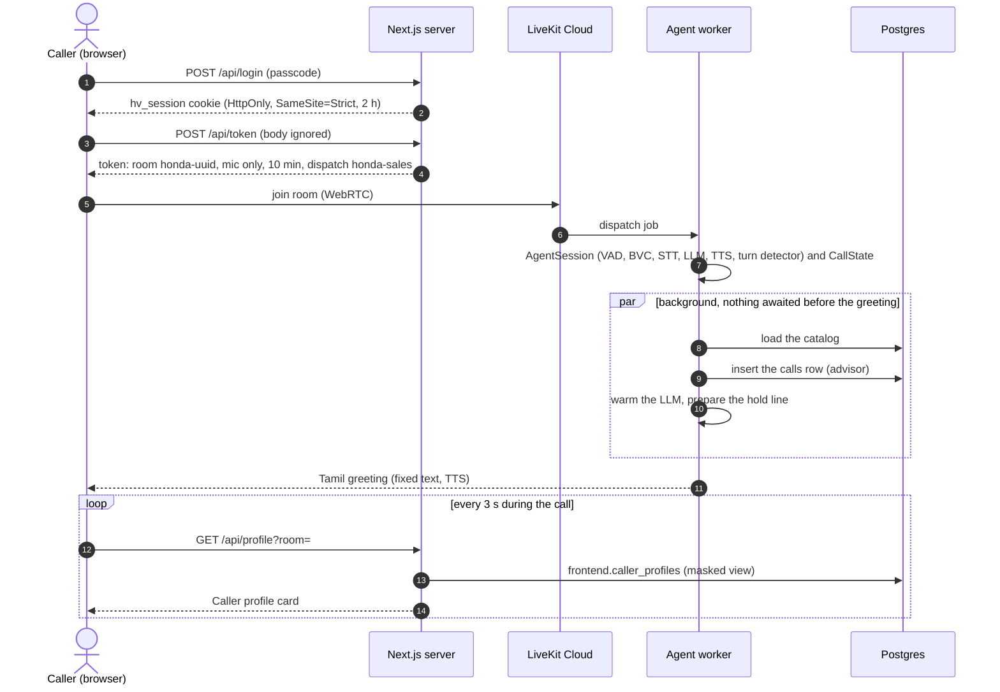

<details>
<summary>draw.io XML (<code>diagrams/02-call-setup.drawio</code>)</summary>

```xml
<mxfile host="app.diagrams.net">
  <diagram id="02 Call setup" name="02 Call setup">
    <mxGraphModel dx="1400" dy="900" grid="1" gridSize="10" guides="1" page="1" pageWidth="1600" pageHeight="1100">
      <root>
        <mxCell id="0" />
        <mxCell id="1" parent="0" />
        <mxCell id="s1" value="1. Caller opens the page&lt;br&gt;enters DEMO_PASSCODE" style="rounded=1;whiteSpace=wrap;html=1;fillColor=#dae8fc;strokeColor=#6c8ebf;" vertex="1" parent="1">
          <mxGeometry x="20" y="40" width="200" height="70" as="geometry" />
        </mxCell>
        <mxCell id="s2" value="2. POST /api/login&lt;br&gt;constant-time check, 5/min/IP&lt;br&gt;sets hv_session cookie&lt;br&gt;(HttpOnly, SameSite=Strict, 2 h)" style="rounded=1;whiteSpace=wrap;html=1;fillColor=#d5e8d4;strokeColor=#82b366;" vertex="1" parent="1">
          <mxGeometry x="260" y="30" width="230" height="90" as="geometry" />
        </mxCell>
        <mxCell id="s3" value="3. Start call: POST /api/token&lt;br&gt;cookie checked, 10/min/IP&lt;br&gt;body ignored" style="rounded=1;whiteSpace=wrap;html=1;fillColor=#d5e8d4;strokeColor=#82b366;" vertex="1" parent="1">
          <mxGeometry x="530" y="30" width="220" height="90" as="geometry" />
        </mxCell>
        <mxCell id="s4" value="4. Token signed locally with API secret:&lt;br&gt;room honda-&amp;lt;uuid&amp;gt;, caller-&amp;lt;uuid&amp;gt;&lt;br&gt;mic only, no data, 10 min,&lt;br&gt;dispatch agent honda-sales" style="rounded=1;whiteSpace=wrap;html=1;fillColor=#d5e8d4;strokeColor=#82b366;" vertex="1" parent="1">
          <mxGeometry x="790" y="30" width="260" height="90" as="geometry" />
        </mxCell>
        <mxCell id="s5" value="5. Browser joins the room&lt;br&gt;on LiveKit Cloud (WebRTC)" style="rounded=1;whiteSpace=wrap;html=1;fillColor=#dae8fc;strokeColor=#6c8ebf;" vertex="1" parent="1">
          <mxGeometry x="790" y="180" width="260" height="70" as="geometry" />
        </mxCell>
        <mxCell id="s6" value="6. LiveKit dispatches a job&lt;br&gt;to a worker registered as&lt;br&gt;honda-sales (load &amp;lt; 1.0)" style="rounded=1;whiteSpace=wrap;html=1;fillColor=#fff2cc;strokeColor=#d6b656;" vertex="1" parent="1">
          <mxGeometry x="530" y="180" width="220" height="80" as="geometry" />
        </mxCell>
        <mxCell id="s7" value="7. Worker entrypoint: AgentSession&lt;br&gt;(VAD, STT, LLM, TTS, turn detector),&lt;br&gt;CallState, catalog loads in background" style="rounded=1;whiteSpace=wrap;html=1;fillColor=#d5e8d4;strokeColor=#82b366;" vertex="1" parent="1">
          <mxGeometry x="230" y="180" width="260" height="80" as="geometry" />
        </mxCell>
        <mxCell id="s8" value="8. Tamil greeting (fixed text, no LLM)&lt;br&gt;LLM warm-up in parallel;&lt;br&gt;10-min call limit timer; hold audio ready" style="rounded=1;whiteSpace=wrap;html=1;fillColor=#d5e8d4;strokeColor=#82b366;" vertex="1" parent="1">
          <mxGeometry x="230" y="300" width="260" height="80" as="geometry" />
        </mxCell>
        <mxCell id="s9" value="9. Conversation turns&lt;br&gt;(see 03 Voice turn)" style="ellipse;whiteSpace=wrap;html=1;fillColor=#d5e8d4;strokeColor=#82b366;" vertex="1" parent="1">
          <mxGeometry x="20" y="300" width="170" height="80" as="geometry" />
        </mxCell>
        <mxCell id="e0" value="" style="edgeStyle=orthogonalEdgeStyle;rounded=1;html=1;endArrow=block;endFill=1;fontSize=10;" edge="1" parent="1" source="s1" target="s2">
          <mxGeometry relative="1" as="geometry" />
        </mxCell>
        <mxCell id="e1" value="" style="edgeStyle=orthogonalEdgeStyle;rounded=1;html=1;endArrow=block;endFill=1;fontSize=10;" edge="1" parent="1" source="s2" target="s3">
          <mxGeometry relative="1" as="geometry" />
        </mxCell>
        <mxCell id="e2" value="" style="edgeStyle=orthogonalEdgeStyle;rounded=1;html=1;endArrow=block;endFill=1;fontSize=10;" edge="1" parent="1" source="s3" target="s4">
          <mxGeometry relative="1" as="geometry" />
        </mxCell>
        <mxCell id="e3" value="token" style="edgeStyle=orthogonalEdgeStyle;rounded=1;html=1;endArrow=block;endFill=1;fontSize=10;" edge="1" parent="1" source="s4" target="s5">
          <mxGeometry relative="1" as="geometry" />
        </mxCell>
        <mxCell id="e4" value="" style="edgeStyle=orthogonalEdgeStyle;rounded=1;html=1;endArrow=block;endFill=1;fontSize=10;" edge="1" parent="1" source="s5" target="s6">
          <mxGeometry relative="1" as="geometry" />
        </mxCell>
        <mxCell id="e5" value="" style="edgeStyle=orthogonalEdgeStyle;rounded=1;html=1;endArrow=block;endFill=1;fontSize=10;" edge="1" parent="1" source="s6" target="s7">
          <mxGeometry relative="1" as="geometry" />
        </mxCell>
        <mxCell id="e6" value="" style="edgeStyle=orthogonalEdgeStyle;rounded=1;html=1;endArrow=block;endFill=1;fontSize=10;" edge="1" parent="1" source="s7" target="s8">
          <mxGeometry relative="1" as="geometry" />
        </mxCell>
        <mxCell id="e7" value="" style="edgeStyle=orthogonalEdgeStyle;rounded=1;html=1;endArrow=block;endFill=1;fontSize=10;" edge="1" parent="1" source="s8" target="s9">
          <mxGeometry relative="1" as="geometry" />
        </mxCell>
      </root>
    </mxGraphModel>
  </diagram>
</mxfile>
```

</details>

---

## 5. Workflow: one voice turn

1. **Listening.** The browser streams microphone audio to LiveKit; the worker receives it. The BVC filter removes background voices and noise; Silero VAD marks speech; Sarvam `saaras:v4` transcribes while the caller talks (interim text) and reports the detected language.
2. **End of turn.** LiveKit's turn detector decides the caller has finished (typically ~0.6 s after they stop). To save time, the LLM is already started on the draft transcript (preemptive generation) and TTS is allowed to start early too.
3. **Language (code).** The session language changes on an explicit request ("Telugu lo cheppandi"), or on a turn of at least 3 words in another language: the transcript's native script decides, else STT's confident detection (script outranks STT's tag, which once called a Tamil-script turn Hindi). So "ok" never flips a Tamil call to English (SPEC §4.1).
4. **Reply from code, if possible.** On the caller's first turn, a bare language pick ("Tamil", "English please") gets the intro line straight from code, with no LLM call.
5. **Context for the LLM.** Code adds, for this turn only: facts for any model the caller named (pre-fetched, so most product answers need one LLM call, not two), a competitor pivot to the closest Honda, an out-of-scope note, the sales advisor's suggested move for this turn (at most one, §7), and, last, the language tag (booking turns also get the current IST time and booking progress).
6. **LLM.** `gpt-5.4-mini` streams its reply, or calls a tool. Tools take typed arguments and run code or parameterised SQL; the LLM never writes SQL. Prices and EMIs are spoken only from tool output. Fixed lines (the booking read-back, the booked line, the callback-consent read-back) are spoken straight from the tool's output without a second LLM call.
7. **Speech.** The reply streams through `tts_node`: markdown and emoji are stripped, raw ₹ amounts are rewritten by the price formatter, units are expanded, and any echoed internal tag is dropped. Then Sarvam `bulbul:v4-flash` speaks it in the session language.
8. **Slow turns.** If the agent is still thinking after 2 s (slow tool, slow LLM), a short line ("One moment please, let me check.") plays on a separate audio track. Once started, it finishes before the reply plays (at most 4 s; the reply is synthesised meanwhile), and it stops at once if the caller speaks. Hold music was tried and removed.
9. **Caller signals (background).** When the caller's message is committed, the advisor asks `gpt-5.4-nano` about it in parallel (§7). Nothing on the reply path waits for it.
10. **Metrics.** Each turn writes one line to `logs/turns.jsonl` (time to first audio, STT, LLM time to first token, TTS first byte, tools, words, guardrail violations); the worker log goes to `logs/worker.log` during development.

Typical timings (2026-10-16 console and browser calls): end of turn ~0.58 s, LLM first token 0.8–1.0 s, TTS first audio 0.2–0.3 s; **caller hears the reply ~1.5 s after they stop** (target: median ≤ 2.0 s, 90th percentile ≤ 3.0 s).

### Diagram 3: Voice turn

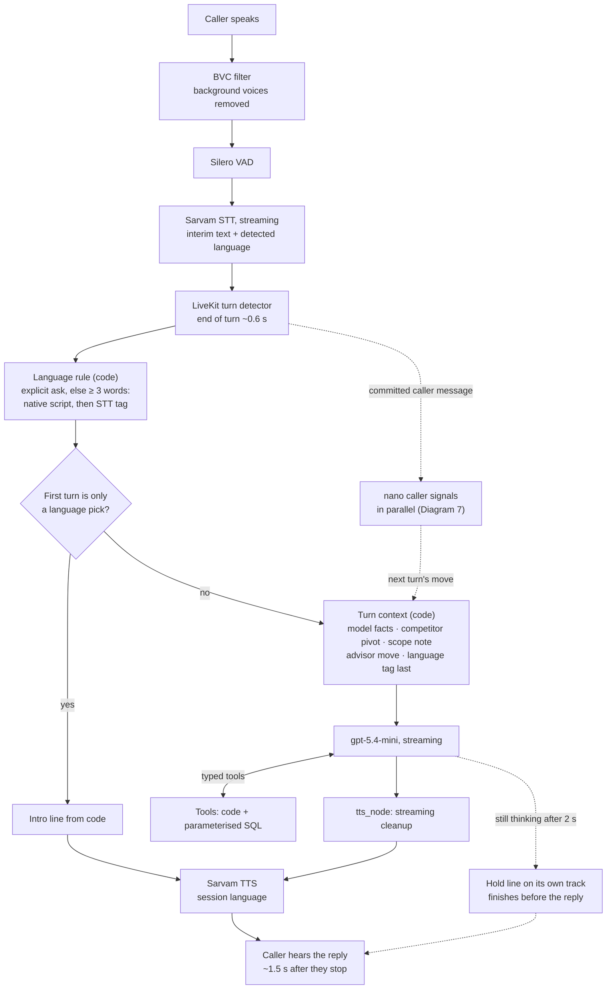

<details>
<summary>draw.io XML (<code>diagrams/03-voice-turn.drawio</code>)</summary>

```xml
<mxfile host="app.diagrams.net">
  <diagram id="03 Voice turn" name="03 Voice turn">
    <mxGraphModel dx="1400" dy="900" grid="1" gridSize="10" guides="1" page="1" pageWidth="1600" pageHeight="1100">
      <root>
        <mxCell id="0" />
        <mxCell id="1" parent="0" />
        <mxCell id="mic" value="Caller speaks&lt;br&gt;(browser mic)" style="rounded=1;whiteSpace=wrap;html=1;fillColor=#dae8fc;strokeColor=#6c8ebf;" vertex="1" parent="1">
          <mxGeometry x="20" y="40" width="140" height="60" as="geometry" />
        </mxCell>
        <mxCell id="vad" value="Silero VAD (local)&lt;br&gt;speech start/stop" style="rounded=1;whiteSpace=wrap;html=1;fillColor=#f5f5f5;strokeColor=#666666;dashed=1;" vertex="1" parent="1">
          <mxGeometry x="200" y="40" width="160" height="60" as="geometry" />
        </mxCell>
        <mxCell id="stt" value="Sarvam saaras:v4 STT&lt;br&gt;streaming, codemix,&lt;br&gt;language auto-detect" style="rounded=1;whiteSpace=wrap;html=1;fillColor=#e1d5e7;strokeColor=#9673a6;" vertex="1" parent="1">
          <mxGeometry x="400" y="30" width="180" height="80" as="geometry" />
        </mxCell>
        <mxCell id="eou" value="LiveKit turn detector (cloud)&lt;br&gt;end of turn ~0.3-1.5 s" style="rounded=1;whiteSpace=wrap;html=1;fillColor=#fff2cc;strokeColor=#d6b656;" vertex="1" parent="1">
          <mxGeometry x="620" y="30" width="200" height="80" as="geometry" />
        </mxCell>
        <mxCell id="lang" value="Code: session language rule&lt;br&gt;(&amp;gt;= 3 words + confident, or asked)" style="rounded=1;whiteSpace=wrap;html=1;fillColor=#d5e8d4;strokeColor=#82b366;" vertex="1" parent="1">
          <mxGeometry x="620" y="150" width="200" height="70" as="geometry" />
        </mxCell>
        <mxCell id="fixed" value="Fixed reply in code?&lt;br&gt;(first turn = language pick)" style="rhombus;whiteSpace=wrap;html=1;fillColor=#fff2cc;strokeColor=#d6b656;" vertex="1" parent="1">
          <mxGeometry x="400" y="140" width="180" height="100" as="geometry" />
        </mxCell>
        <mxCell id="pre" value="Pre-fetch in code: model facts,&lt;br&gt;competitor pivot, out-of-scope note&lt;br&gt;+ language tag LAST" style="rounded=1;whiteSpace=wrap;html=1;fillColor=#d5e8d4;strokeColor=#82b366;" vertex="1" parent="1">
          <mxGeometry x="160" y="150" width="210" height="80" as="geometry" />
        </mxCell>
        <mxCell id="llm" value="Azure gpt-5.4-mini&lt;br&gt;streaming tokens, tools&lt;br&gt;(4 s stall limit, retry, fallback)" style="rounded=1;whiteSpace=wrap;html=1;fillColor=#e1d5e7;strokeColor=#9673a6;" vertex="1" parent="1">
          <mxGeometry x="160" y="280" width="210" height="80" as="geometry" />
        </mxCell>
        <mxCell id="tools" value="Tools (typed, code + SQL)&lt;br&gt;find_bike, check_slots, ..." style="rounded=1;whiteSpace=wrap;html=1;fillColor=#d5e8d4;strokeColor=#82b366;" vertex="1" parent="1">
          <mxGeometry x="400" y="280" width="180" height="80" as="geometry" />
        </mxCell>
        <mxCell id="clean" value="tts_node: streaming cleanup&lt;br&gt;tag filter, Rs backstop, cc/kmpl" style="rounded=1;whiteSpace=wrap;html=1;fillColor=#d5e8d4;strokeColor=#82b366;" vertex="1" parent="1">
          <mxGeometry x="620" y="280" width="200" height="80" as="geometry" />
        </mxCell>
        <mxCell id="tts" value="Sarvam bulbul:v4-flash&lt;br&gt;voice aarti_hi_customer&lt;br&gt;language = session language" style="rounded=1;whiteSpace=wrap;html=1;fillColor=#e1d5e7;strokeColor=#9673a6;" vertex="1" parent="1">
          <mxGeometry x="620" y="400" width="200" height="80" as="geometry" />
        </mxCell>
        <mxCell id="out" value="Caller hears the reply&lt;br&gt;(~1.5 s after they stop)" style="rounded=1;whiteSpace=wrap;html=1;fillColor=#dae8fc;strokeColor=#6c8ebf;" vertex="1" parent="1">
          <mxGeometry x="400" y="410" width="180" height="60" as="geometry" />
        </mxCell>
        <mxCell id="hold" value="After 2 s thinking: hold line&lt;br&gt;(own audio track)" style="rounded=1;whiteSpace=wrap;html=1;fillColor=#f5f5f5;strokeColor=#666666;dashed=1;" vertex="1" parent="1">
          <mxGeometry x="160" y="400" width="210" height="70" as="geometry" />
        </mxCell>
        <mxCell id="e0" value="" style="edgeStyle=orthogonalEdgeStyle;rounded=1;html=1;endArrow=block;endFill=1;fontSize=10;" edge="1" parent="1" source="mic" target="vad">
          <mxGeometry relative="1" as="geometry" />
        </mxCell>
        <mxCell id="e1" value="audio" style="edgeStyle=orthogonalEdgeStyle;rounded=1;html=1;endArrow=block;endFill=1;fontSize=10;" edge="1" parent="1" source="vad" target="stt">
          <mxGeometry relative="1" as="geometry" />
        </mxCell>
        <mxCell id="e2" value="interim text" style="edgeStyle=orthogonalEdgeStyle;rounded=1;html=1;endArrow=block;endFill=1;fontSize=10;" edge="1" parent="1" source="stt" target="eou">
          <mxGeometry relative="1" as="geometry" />
        </mxCell>
        <mxCell id="e3" value="final transcript" style="edgeStyle=orthogonalEdgeStyle;rounded=1;html=1;endArrow=block;endFill=1;fontSize=10;" edge="1" parent="1" source="eou" target="lang">
          <mxGeometry relative="1" as="geometry" />
        </mxCell>
        <mxCell id="e4" value="" style="edgeStyle=orthogonalEdgeStyle;rounded=1;html=1;endArrow=block;endFill=1;fontSize=10;" edge="1" parent="1" source="lang" target="fixed">
          <mxGeometry relative="1" as="geometry" />
        </mxCell>
        <mxCell id="e5" value="yes: intro text -&gt; TTS" style="edgeStyle=orthogonalEdgeStyle;rounded=1;html=1;endArrow=block;endFill=1;fontSize=10;dashed=1;" edge="1" parent="1" source="fixed" target="out">
          <mxGeometry relative="1" as="geometry" />
        </mxCell>
        <mxCell id="e6" value="no" style="edgeStyle=orthogonalEdgeStyle;rounded=1;html=1;endArrow=block;endFill=1;fontSize=10;" edge="1" parent="1" source="fixed" target="pre">
          <mxGeometry relative="1" as="geometry" />
        </mxCell>
        <mxCell id="e7" value="" style="edgeStyle=orthogonalEdgeStyle;rounded=1;html=1;endArrow=block;endFill=1;fontSize=10;" edge="1" parent="1" source="pre" target="llm">
          <mxGeometry relative="1" as="geometry" />
        </mxCell>
        <mxCell id="e8" value="tool call" style="edgeStyle=orthogonalEdgeStyle;rounded=1;html=1;endArrow=block;endFill=1;fontSize=10;" edge="1" parent="1" source="llm" target="tools">
          <mxGeometry relative="1" as="geometry" />
        </mxCell>
        <mxCell id="e9" value="result" style="edgeStyle=orthogonalEdgeStyle;rounded=1;html=1;endArrow=block;endFill=1;fontSize=10;dashed=1;" edge="1" parent="1" source="tools" target="llm">
          <mxGeometry relative="1" as="geometry" />
        </mxCell>
        <mxCell id="e10" value="text stream" style="edgeStyle=orthogonalEdgeStyle;rounded=1;html=1;endArrow=block;endFill=1;fontSize=10;" edge="1" parent="1" source="llm" target="clean">
          <mxGeometry relative="1" as="geometry" />
        </mxCell>
        <mxCell id="e11" value="" style="edgeStyle=orthogonalEdgeStyle;rounded=1;html=1;endArrow=block;endFill=1;fontSize=10;" edge="1" parent="1" source="clean" target="tts">
          <mxGeometry relative="1" as="geometry" />
        </mxCell>
        <mxCell id="e12" value="audio" style="edgeStyle=orthogonalEdgeStyle;rounded=1;html=1;endArrow=block;endFill=1;fontSize=10;" edge="1" parent="1" source="tts" target="out">
          <mxGeometry relative="1" as="geometry" />
        </mxCell>
        <mxCell id="e13" value="slow" style="edgeStyle=orthogonalEdgeStyle;rounded=1;html=1;endArrow=block;endFill=1;fontSize=10;dashed=1;" edge="1" parent="1" source="llm" target="hold">
          <mxGeometry relative="1" as="geometry" />
        </mxCell>
      </root>
    </mxGraphModel>
  </diagram>
</mxfile>
```

</details>

---

## 6. Workflow: agents, handoff and booking

Two agents share one call state:
- **SalesAgent** is advisor-style: it answers model, price, spec, comparison and showroom-hours questions, suggests models for a need (`recommend_bikes`), gives demo EMI examples (`emi_examples`), takes callback requests (`capture_lead`), and hands over to booking with `start_booking` (passing the model, day and time if the caller already said them). There is no separate lead agent: callers move between needs and named models within seconds, and each handoff costs an extra LLM step.
- **BookingAgent** runs the booking script and hands back with `back_to_sales` for other questions. The conversation history moves with each handoff. The advisor suggests nothing during booking.
- **CallState** holds what must not depend on the LLM's memory: session language, caller turn count, chosen model, the booking draft (slots actually offered, licence answer, validated phone numbers, the read-back, the caller's chosen time, booking codes made in this call), the pending callback read-back (`lead_pending`), the call's outcomes, its `calls` row id and the advisor.

**Booking script** (one question at a time):
1. Model (pre-filled if known). Pre-booking and upcoming models can't be test-ridden: the agent offers a callback instead.
2. Day and time. The slot search runs in code (on entry if the caller already gave them), against real free capacity (2 demo bikes per model per 30-minute slot), on the showroom's IST grid. The LLM only extracts `day_ref` and `time_24h`; code does the date arithmetic.
3. "Do you have a valid two-wheeler driving licence?" No licence: no booking, callback offered.
4. Name, then mobile number (`validate_phone`: digits or number words in any of the six languages, 2 tries).
5. **One read-back, built in code:** model, slot, name, number digit by digit in 5+5 groups, and the licence.
6. Only if the caller says yes **in the very next turn**, `book_test_ride` passes the guard (slot offered, licence yes, phone validated, details equal to the read-back) and calls the atomic `reserve_slot` function in Postgres. If someone else just took the slot, the 2 nearest alternatives are offered and a new read-back follows.
7. The booking code is spoken letter by letter ("H N D, 7 K 3 Q 9"); the calendar copy is made in the background.

**Cancellation** needs the booking code and the phone number that booked it. Afterwards the calendar event is deleted in the background.

### Diagram 4: Agents and tools

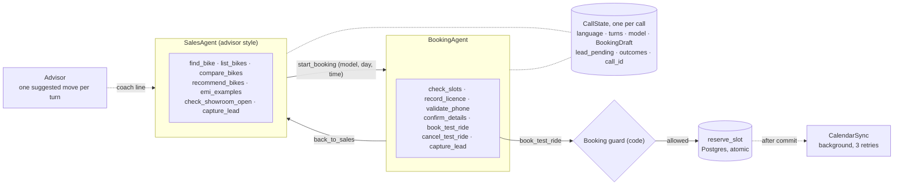

<details>
<summary>draw.io XML (<code>diagrams/04-agents-tools.drawio</code>)</summary>

```xml
<mxfile host="app.diagrams.net">
  <diagram id="04 Agents and tools" name="04 Agents and tools">
    <mxGraphModel dx="1400" dy="900" grid="1" gridSize="10" guides="1" page="1" pageWidth="1600" pageHeight="1100">
      <root>
        <mxCell id="0" />
        <mxCell id="1" parent="0" />
        <mxCell id="state" value="CallState (shared by both agents, one per call)&lt;br&gt;session language, caller turns, chosen model,&lt;br&gt;BookingDraft: offered slots, licence, validated phones,&lt;br&gt;read-back (pending), chosen-time hint, booking codes" style="shape=note;whiteSpace=wrap;html=1;size=14;fillColor=#fafafa;strokeColor=#999999;align=left;spacingLeft=6;" vertex="1" parent="1">
          <mxGeometry x="300" y="20" width="380" height="100" as="geometry" />
        </mxCell>
        <mxCell id="sales" value="SalesAgent&lt;br&gt;find_bike, list_bikes, compare_bikes,&lt;br&gt;check_showroom_open, capture_lead,&lt;br&gt;start_booking(model, day, time)" style="rounded=1;whiteSpace=wrap;html=1;fillColor=#d5e8d4;strokeColor=#82b366;" vertex="1" parent="1">
          <mxGeometry x="40" y="170" width="300" height="110" as="geometry" />
        </mxCell>
        <mxCell id="book" value="BookingAgent&lt;br&gt;check_slots, record_licence, validate_phone,&lt;br&gt;confirm_details, book_test_ride,&lt;br&gt;cancel_test_ride, capture_lead, back_to_sales" style="rounded=1;whiteSpace=wrap;html=1;fillColor=#d5e8d4;strokeColor=#82b366;" vertex="1" parent="1">
          <mxGeometry x="640" y="170" width="320" height="110" as="geometry" />
        </mxCell>
        <mxCell id="guard" value="domain/booking_guard.py&lt;br&gt;slot offered, licence yes, phone validated,&lt;br&gt;yes in the turn right after the read-back,&lt;br&gt;details equal the read-back" style="rhombus;whiteSpace=wrap;html=1;fillColor=#fff2cc;strokeColor=#d6b656;" vertex="1" parent="1">
          <mxGeometry x="640" y="330" width="320" height="150" as="geometry" />
        </mxCell>
        <mxCell id="dbfn" value="Postgres reserve_slot / cancel_booking&lt;br&gt;atomic, capacity 2, licence check" style="shape=cylinder3;whiteSpace=wrap;html=1;boundedLbl=1;size=12;fillColor=#f8cecc;strokeColor=#b85450;" vertex="1" parent="1">
          <mxGeometry x="640" y="520" width="320" height="90" as="geometry" />
        </mxCell>
        <mxCell id="cal" value="CalendarSync (background)&lt;br&gt;create / delete event, 3 retries" style="rounded=1;whiteSpace=wrap;html=1;fillColor=#fff2cc;strokeColor=#d6b656;" vertex="1" parent="1">
          <mxGeometry x="300" y="540" width="260" height="70" as="geometry" />
        </mxCell>
        <mxCell id="e0" value="start_booking (handoff + chat history)" style="edgeStyle=orthogonalEdgeStyle;rounded=1;html=1;endArrow=block;endFill=1;fontSize=10;" edge="1" parent="1" source="sales" target="book">
          <mxGeometry relative="1" as="geometry" />
        </mxCell>
        <mxCell id="e1" value="back_to_sales" style="edgeStyle=orthogonalEdgeStyle;rounded=1;html=1;endArrow=block;endFill=1;fontSize=10;dashed=1;" edge="1" parent="1" source="book" target="sales">
          <mxGeometry relative="1" as="geometry" />
        </mxCell>
        <mxCell id="e2" value="" style="edgeStyle=orthogonalEdgeStyle;rounded=1;html=1;endArrow=block;endFill=1;fontSize=10;dashed=1;" edge="1" parent="1" source="sales" target="state">
          <mxGeometry relative="1" as="geometry" />
        </mxCell>
        <mxCell id="e3" value="" style="edgeStyle=orthogonalEdgeStyle;rounded=1;html=1;endArrow=block;endFill=1;fontSize=10;dashed=1;" edge="1" parent="1" source="book" target="state">
          <mxGeometry relative="1" as="geometry" />
        </mxCell>
        <mxCell id="e4" value="book_test_ride" style="edgeStyle=orthogonalEdgeStyle;rounded=1;html=1;endArrow=block;endFill=1;fontSize=10;" edge="1" parent="1" source="book" target="guard">
          <mxGeometry relative="1" as="geometry" />
        </mxCell>
        <mxCell id="e5" value="allowed" style="edgeStyle=orthogonalEdgeStyle;rounded=1;html=1;endArrow=block;endFill=1;fontSize=10;" edge="1" parent="1" source="guard" target="dbfn">
          <mxGeometry relative="1" as="geometry" />
        </mxCell>
        <mxCell id="e6" value="after commit" style="edgeStyle=orthogonalEdgeStyle;rounded=1;html=1;endArrow=block;endFill=1;fontSize=10;dashed=1;" edge="1" parent="1" source="dbfn" target="cal">
          <mxGeometry relative="1" as="geometry" />
        </mxCell>
      </root>
    </mxGraphModel>
  </diagram>
</mxfile>
```

</details>

### Diagram 5: Booking flow

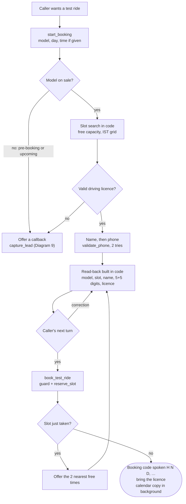

<details>
<summary>draw.io XML (<code>diagrams/05-booking-flow.drawio</code>)</summary>

```xml
<mxfile host="app.diagrams.net">
  <diagram id="05 Booking flow" name="05 Booking flow">
    <mxGraphModel dx="1400" dy="900" grid="1" gridSize="10" guides="1" page="1" pageWidth="1600" pageHeight="1100">
      <root>
        <mxCell id="0" />
        <mxCell id="1" parent="0" />
        <mxCell id="b0" value="Caller wants a test ride" style="rounded=1;whiteSpace=wrap;html=1;fillColor=#dae8fc;strokeColor=#6c8ebf;" vertex="1" parent="1">
          <mxGeometry x="20" y="40" width="180" height="60" as="geometry" />
        </mxCell>
        <mxCell id="b1" value="start_booking&lt;br&gt;model (+ day, time)" style="rounded=1;whiteSpace=wrap;html=1;fillColor=#d5e8d4;strokeColor=#82b366;" vertex="1" parent="1">
          <mxGeometry x="240" y="40" width="180" height="60" as="geometry" />
        </mxCell>
        <mxCell id="b2" value="On sale?" style="rhombus;whiteSpace=wrap;html=1;fillColor=#fff2cc;strokeColor=#d6b656;" vertex="1" parent="1">
          <mxGeometry x="460" y="30" width="120" height="80" as="geometry" />
        </mxCell>
        <mxCell id="lead" value="Offer callback&lt;br&gt;capture_lead (needs phone)" style="rounded=1;whiteSpace=wrap;html=1;fillColor=#d5e8d4;strokeColor=#82b366;" vertex="1" parent="1">
          <mxGeometry x="460" y="160" width="160" height="60" as="geometry" />
        </mxCell>
        <mxCell id="b3" value="Slot search in code&lt;br&gt;(free capacity, IST grid)" style="rounded=1;whiteSpace=wrap;html=1;fillColor=#d5e8d4;strokeColor=#82b366;" vertex="1" parent="1">
          <mxGeometry x="640" y="40" width="180" height="60" as="geometry" />
        </mxCell>
        <mxCell id="b4" value="Licence question&lt;br&gt;record_licence" style="rounded=1;whiteSpace=wrap;html=1;fillColor=#d5e8d4;strokeColor=#82b366;" vertex="1" parent="1">
          <mxGeometry x="860" y="40" width="170" height="60" as="geometry" />
        </mxCell>
        <mxCell id="b5" value="Valid licence?" style="rhombus;whiteSpace=wrap;html=1;fillColor=#fff2cc;strokeColor=#d6b656;" vertex="1" parent="1">
          <mxGeometry x="1070" y="30" width="130" height="80" as="geometry" />
        </mxCell>
        <mxCell id="b6" value="Name, then phone&lt;br&gt;validate_phone (2 tries)" style="rounded=1;whiteSpace=wrap;html=1;fillColor=#d5e8d4;strokeColor=#82b366;" vertex="1" parent="1">
          <mxGeometry x="860" y="160" width="170" height="60" as="geometry" />
        </mxCell>
        <mxCell id="b7" value="confirm_details:&lt;br&gt;read-back built in code&lt;br&gt;model, slot, name, 5+5 digits, licence" style="rounded=1;whiteSpace=wrap;html=1;fillColor=#d5e8d4;strokeColor=#82b366;" vertex="1" parent="1">
          <mxGeometry x="860" y="260" width="230" height="80" as="geometry" />
        </mxCell>
        <mxCell id="b8" value="Caller says yes&lt;br&gt;(next turn)?" style="rhombus;whiteSpace=wrap;html=1;fillColor=#fff2cc;strokeColor=#d6b656;" vertex="1" parent="1">
          <mxGeometry x="640" y="250" width="140" height="100" as="geometry" />
        </mxCell>
        <mxCell id="b9" value="book_test_ride&lt;br&gt;guard + reserve_slot" style="rounded=1;whiteSpace=wrap;html=1;fillColor=#d5e8d4;strokeColor=#82b366;" vertex="1" parent="1">
          <mxGeometry x="420" y="260" width="180" height="70" as="geometry" />
        </mxCell>
        <mxCell id="b10" value="Slot just taken?" style="rhombus;whiteSpace=wrap;html=1;fillColor=#fff2cc;strokeColor=#d6b656;" vertex="1" parent="1">
          <mxGeometry x="200" y="250" width="140" height="100" as="geometry" />
        </mxCell>
        <mxCell id="b11" value="Booking code spoken&lt;br&gt;H N D, ...; bring licence;&lt;br&gt;calendar mirror in background" style="ellipse;whiteSpace=wrap;html=1;fillColor=#d5e8d4;strokeColor=#82b366;" vertex="1" parent="1">
          <mxGeometry x="20" y="400" width="220" height="90" as="geometry" />
        </mxCell>
        <mxCell id="b12" value="Offer 2 nearest&lt;br&gt;alternatives" style="rounded=1;whiteSpace=wrap;html=1;fillColor=#d5e8d4;strokeColor=#82b366;" vertex="1" parent="1">
          <mxGeometry x="200" y="140" width="140" height="60" as="geometry" />
        </mxCell>
        <mxCell id="e0" value="" style="edgeStyle=orthogonalEdgeStyle;rounded=1;html=1;endArrow=block;endFill=1;fontSize=10;" edge="1" parent="1" source="b0" target="b1">
          <mxGeometry relative="1" as="geometry" />
        </mxCell>
        <mxCell id="e1" value="" style="edgeStyle=orthogonalEdgeStyle;rounded=1;html=1;endArrow=block;endFill=1;fontSize=10;" edge="1" parent="1" source="b1" target="b2">
          <mxGeometry relative="1" as="geometry" />
        </mxCell>
        <mxCell id="e2" value="no" style="edgeStyle=orthogonalEdgeStyle;rounded=1;html=1;endArrow=block;endFill=1;fontSize=10;" edge="1" parent="1" source="b2" target="lead">
          <mxGeometry relative="1" as="geometry" />
        </mxCell>
        <mxCell id="e3" value="yes" style="edgeStyle=orthogonalEdgeStyle;rounded=1;html=1;endArrow=block;endFill=1;fontSize=10;" edge="1" parent="1" source="b2" target="b3">
          <mxGeometry relative="1" as="geometry" />
        </mxCell>
        <mxCell id="e4" value="" style="edgeStyle=orthogonalEdgeStyle;rounded=1;html=1;endArrow=block;endFill=1;fontSize=10;" edge="1" parent="1" source="b3" target="b4">
          <mxGeometry relative="1" as="geometry" />
        </mxCell>
        <mxCell id="e5" value="" style="edgeStyle=orthogonalEdgeStyle;rounded=1;html=1;endArrow=block;endFill=1;fontSize=10;" edge="1" parent="1" source="b4" target="b5">
          <mxGeometry relative="1" as="geometry" />
        </mxCell>
        <mxCell id="e6" value="no" style="edgeStyle=orthogonalEdgeStyle;rounded=1;html=1;endArrow=block;endFill=1;fontSize=10;" edge="1" parent="1" source="b5" target="lead">
          <mxGeometry relative="1" as="geometry" />
        </mxCell>
        <mxCell id="e7" value="yes" style="edgeStyle=orthogonalEdgeStyle;rounded=1;html=1;endArrow=block;endFill=1;fontSize=10;" edge="1" parent="1" source="b5" target="b6">
          <mxGeometry relative="1" as="geometry" />
        </mxCell>
        <mxCell id="e8" value="" style="edgeStyle=orthogonalEdgeStyle;rounded=1;html=1;endArrow=block;endFill=1;fontSize=10;" edge="1" parent="1" source="b6" target="b7">
          <mxGeometry relative="1" as="geometry" />
        </mxCell>
        <mxCell id="e9" value="" style="edgeStyle=orthogonalEdgeStyle;rounded=1;html=1;endArrow=block;endFill=1;fontSize=10;" edge="1" parent="1" source="b7" target="b8">
          <mxGeometry relative="1" as="geometry" />
        </mxCell>
        <mxCell id="e10" value="correction: new read-back" style="edgeStyle=orthogonalEdgeStyle;rounded=1;html=1;endArrow=block;endFill=1;fontSize=10;dashed=1;" edge="1" parent="1" source="b8" target="b7">
          <mxGeometry relative="1" as="geometry" />
        </mxCell>
        <mxCell id="e11" value="yes" style="edgeStyle=orthogonalEdgeStyle;rounded=1;html=1;endArrow=block;endFill=1;fontSize=10;" edge="1" parent="1" source="b8" target="b9">
          <mxGeometry relative="1" as="geometry" />
        </mxCell>
        <mxCell id="e12" value="" style="edgeStyle=orthogonalEdgeStyle;rounded=1;html=1;endArrow=block;endFill=1;fontSize=10;" edge="1" parent="1" source="b9" target="b10">
          <mxGeometry relative="1" as="geometry" />
        </mxCell>
        <mxCell id="e13" value="no: booked" style="edgeStyle=orthogonalEdgeStyle;rounded=1;html=1;endArrow=block;endFill=1;fontSize=10;" edge="1" parent="1" source="b10" target="b11">
          <mxGeometry relative="1" as="geometry" />
        </mxCell>
        <mxCell id="e14" value="yes" style="edgeStyle=orthogonalEdgeStyle;rounded=1;html=1;endArrow=block;endFill=1;fontSize=10;" edge="1" parent="1" source="b10" target="b12">
          <mxGeometry relative="1" as="geometry" />
        </mxCell>
        <mxCell id="e15" value="caller picks" style="edgeStyle=orthogonalEdgeStyle;rounded=1;html=1;endArrow=block;endFill=1;fontSize=10;dashed=1;" edge="1" parent="1" source="b12" target="b7">
          <mxGeometry relative="1" as="geometry" />
        </mxCell>
      </root>
    </mxGraphModel>
  </diagram>
</mxfile>
```

</details>

---

## 7. Workflow: the sales advisor (Phase 7)

The advisor works out what the caller is looking for and steers the call toward a test ride or a callback, without adding any delay. **nano judges, code decides, the reply LLM speaks** (CLAUDE.md rule 12):

1. **Signals, in the background.** Each committed caller message (a discarded preemptive draft never counts) starts one request to `gpt-5.4-nano` with the last 4 exchanges and the active agent. It answers fixed questions (SPEC §20.2) in a strict JSON schema: intent, use case, rider, priorities, budget as an amount (code maps it to a band), timeline, experience, payment interest, objection, frustration, purchase intent, wants a person. A timeout (8 s) or an error skips that turn and changes nothing.
2. **Profile.** Answers above a confidence threshold merge into the call's `CallerProfile`; a later clear answer replaces an earlier one. Categories only: no transcript text, no sensitive inferences. Each turn's answers go to `call_signals`, the profile to `caller_profiles`, which the Caller profile card shows.
3. **One move per turn, in code.** On the caller's next turn, `domain/advisor.py` picks at most one move from the profile (Diagram 8), and SalesAgent adds it to the turn context as a single line: "only after answering what the caller just asked; skip it if it doesn't fit". Each move is suggested once per call, discovery questions at most 4 times, nothing during booking, and nothing more to sell after a callback offer.
4. **Same-turn needs.** For a need with no model named ("a scooter for my mother"), the reply LLM calls `recommend_bikes` with what it heard, so the first answer doesn't wait for the profile. Code ranks on-sale models from `bike_fit` and the catalog (use case, ease, mileage, electric, power, price, budget) and returns 2–3 with one verified reason each.
5. **EMI.** `emi_examples` computes demo EMIs in code from the catalog price and the demo finance schemes, returned as spoken text and always called an example ("the showroom confirms the actual terms").

`ADVISOR=on` (default) adds the moves; `shadow` records the signals without changing the call; `off` disables the advisor.

### Diagram 7: Signals run beside the reply

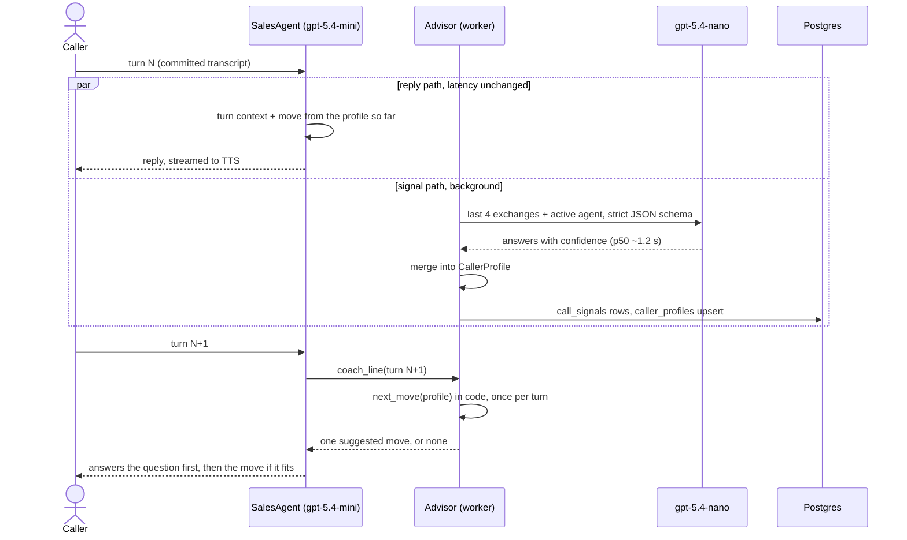

### Diagram 8: Next-move rules (`domain/advisor.py`, first match wins)

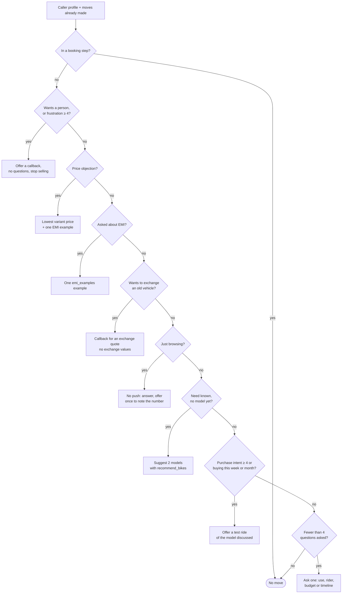

---

## 8. Workflow: callback consent, leads and the end of the call

**Callback consent (DPDP).** A callback is saved only with the caller's explicit consent to the number read back:
1. The caller asks for a callback, or accepts one the agent offers (no licence, model not on sale, out of scope, exchange quote, frustration).
2. `capture_lead` with a validated number doesn't save yet: it returns the consent line (`prompts.LEAD_CONSENT`), spoken straight from code: the number read back 5+5 and "may the showroom call you about this? We'll use the number only for this callback."
3. Only a "yes" in a **later** caller turn, for the **same** number, saves it: the caller is upserted into `customers` (one row per number) with the consent, its time and the consent-text version, and the lead links to that customer and to the call. A "no" saves nothing.
4. If the number fails validation twice, the lead is saved without consent and without a customer row, as before Phase 7.

**At the end of the call** (in the worker's shutdown, after the caller has gone, so nobody waits):
1. In-flight signals get up to 5 s to finish.
2. `gpt-5.4-nano` writes a 2–3 sentence English summary for the person calling back. It refers to "the caller" only; code also scrubs digit runs, booking codes and known names.
3. `domain/lead_score.py` scores the call from the profile and the outcome (below) and writes one next-action line ("Share current EMI and offers for Honda Activa 125").
4. `calls.finish` records the outcome (info, booked, lead, cancelled, dropped), the languages and the summary; links this call's bookings and leads to customers (a booking is not a callback consent); and scores the leads. The Leads tab lists them hottest first, with a CSV export.

| Lead score input | Points |
|---|---|
| Highest purchase intent (1–5) | (intent − 1) × 12, up to 48 |
| Timeline | this week 25, this month 20, 1–3 months 15, browsing 0, unknown 5 |
| Models discussed or suggested | 5 each, up to 10 |
| Test ride booked | +20 |
| Asked about EMI or exchange | +5 |
| Frustration ≥ 4 | −10 |
| **Band** | **hot ≥ 70, warm 40–69, cold < 40** |

### Diagram 9: Callback consent

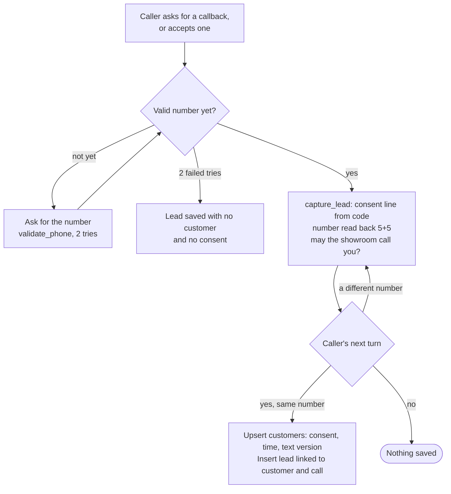

### Diagram 10: End of the call

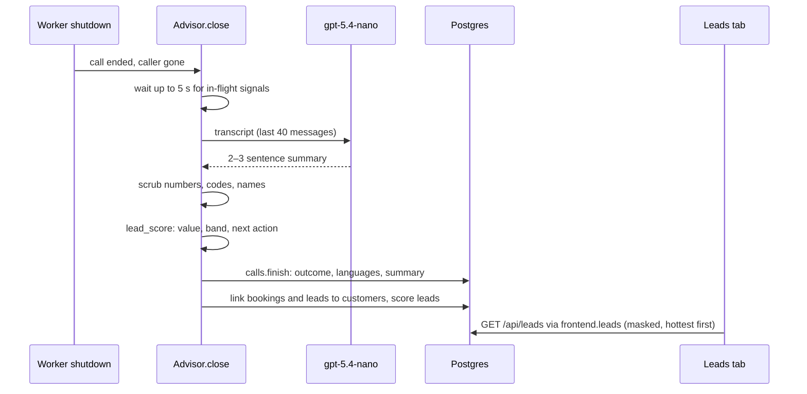

---

## 9. Data

Supabase Postgres (Mumbai) is the source of truth (migrations `001`–`005` in `data/migrations/`; every table has row-level security on):

| Table / object | Contents |
|---|---|
| `showrooms` | Opening hours, closed weekdays, slot length (30 min) |
| `bikes`, `bike_variants`, `bike_aliases`, `bike_on_road_prices` | 33 models from the hand-curated catalog, completed in Phase 7 from BikeDekho/BikeWale with sources: ex-showroom prices, Delhi on-road prices with breakdown, mileage, colours, features, spoken-name aliases. Estimated values are flagged and never spoken |
| `bike_fit` | Per model: kerb weight, seat height, ease score 1–5, use cases, rider fit (used by `recommend_bikes`) |
| `finance_schemes` | Three demo schemes (rate, tenures, down payment), marked `is_demo` |
| `slots` | One row per model per 30-minute slot, capacity 2 (demo bikes) |
| `bookings` | Reference (`HND-XXXXX`), slot, name, phone, language, licence confirmed, calendar sync status, customer and call |
| `customers` | The customer list: one row per phone number, callback consent with time and text version |
| `calls` | One row per call: room, start and end, languages, outcome, summary, highest purchase intent, customer |
| `caller_profiles` | The call's profile: use case, rider, priorities, budget band, timeline, experience, payment interest, objections, models discussed and suggested |
| `call_signals` | Each turn's answers from the signal model, with confidence, provider and latency |
| `leads` | Callback requests, with customer, call, score, band, status, next action and the model of interest |
| `reserve_slot`, `cancel_booking` | Atomic Postgres functions (capacity check + insert in one transaction; 20 simultaneous attempts on a 1-bike slot give exactly 1 booking) |
| `frontend.bookings`, `frontend.catalog`, `frontend.leads`, `frontend.caller_profiles` | Masked views for the website ("Ravi K.", "90xxx xx345"), the only things the read-only role can see |

**Google Calendar** is a write-only copy: after a booking commits, a background task creates an event whose ID is derived from the booking code (so retries never duplicate). A failure marks the row `FAILED` and `scripts/retry_calendar_sync.py` catches up; the caller never hears about it.

### Diagram 11: Data model

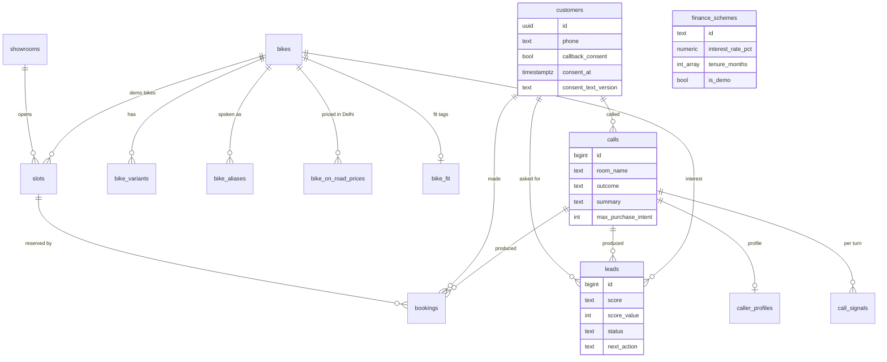

---

## 10. Security, privacy and resilience

**Security boundaries**
- Secrets live only in git-ignored `.env` / `frontend/.env.local`; none reach the browser (checked by scanning the built bundle).
- The browser gets a passcode-gated session, a one-room, microphone-only, 10-minute LiveKit token, and masked panel data.
- The website reads the database through `frontend_reader`, a role that can only `SELECT` the four masked views (bookings, catalog, leads, caller profiles), in read-only transactions, with 3 connections at most. `/api/profile` accepts only room names of the token route's form; the CSV export escapes cells that start with `= + - @` (spreadsheet formula injection).
- The worker uses the backend role; every public table has row-level security on and Supabase's public API roles have no access; the booking functions can't be called through Supabase's API.
- Both database connections use TLS **with certificate verification** against Supabase's root CA (`certs/`).
- The LLM never sees credentials, never writes SQL, and can only call typed tools. Bookings pass a code guard (CLAUDE.md rule 6), not the LLM's judgment.

**Privacy:** calls aren't recorded; phone numbers are masked in logs, the calendar and the website; a privacy notice is shown before the call. The caller profile holds categories only (no transcript text, no sensitive inferences such as income, caste, religion or health); the call summary has no names, numbers or booking codes; a callback number is stored only with explicit consent, recorded with its time and wording version. Processors: LiveKit (media relay, voice filter), Sarvam (audio), Azure (text: replies, signals, summary), Google (masked booking), Supabase (data).

**Resilience and cost limits**
- A stalled LLM request (no bytes for 4 s) is retried quickly; with a fallback deployment configured, errors, rate-limit refusals and stalls switch the call to it, and the primary is used again once healthy.
- Slow turns get a short hold line ("One moment please, let me check.") instead of silence.
- The advisor is analytics and coaching only: a failed signal, summary or database write is logged and skipped, and never affects the call.
- Each worker takes at most 3 calls at once; calls end after 10 minutes with a goodbye line; the website rate-limits sign-ins and tokens.

### Diagram 12: Security boundaries

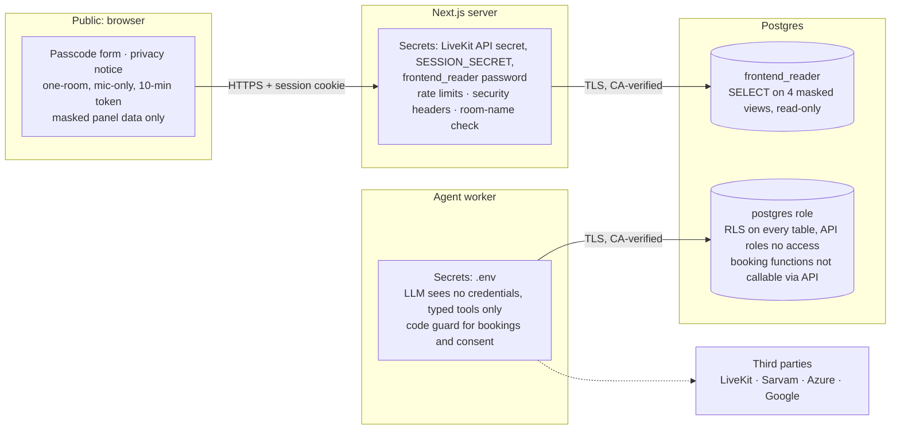

<details>
<summary>draw.io XML (<code>diagrams/06-security.drawio</code>)</summary>

```xml
<mxfile host="app.diagrams.net">
  <diagram id="06 Security boundaries" name="06 Security boundaries">
    <mxGraphModel dx="1400" dy="900" grid="1" gridSize="10" guides="1" page="1" pageWidth="1600" pageHeight="1100">
      <root>
        <mxCell id="0" />
        <mxCell id="1" parent="0" />
        <mxCell id="pub" value="Public internet / browser&lt;br&gt;sees: passcode form, masked panel data,&lt;br&gt;one-room mic-only LiveKit token" style="rounded=1;whiteSpace=wrap;html=1;fillColor=#dae8fc;strokeColor=#6c8ebf;" vertex="1" parent="1">
          <mxGeometry x="20" y="40" width="300" height="90" as="geometry" />
        </mxCell>
        <mxCell id="next" value="Next.js server (secrets: LiveKit API secret,&lt;br&gt;SESSION_SECRET, frontend_reader password)&lt;br&gt;rate limits, security headers" style="rounded=1;whiteSpace=wrap;html=1;fillColor=#d5e8d4;strokeColor=#82b366;" vertex="1" parent="1">
          <mxGeometry x="380" y="40" width="320" height="90" as="geometry" />
        </mxCell>
        <mxCell id="ro" value="frontend_reader role&lt;br&gt;SELECT on 2 masked views only,&lt;br&gt;read-only, 3 connections" style="shape=cylinder3;whiteSpace=wrap;html=1;boundedLbl=1;size=12;fillColor=#f8cecc;strokeColor=#b85450;" vertex="1" parent="1">
          <mxGeometry x="380" y="180" width="320" height="90" as="geometry" />
        </mxCell>
        <mxCell id="worker" value="Agent worker (secrets: .env)&lt;br&gt;LLM sees no credentials, typed tools only,&lt;br&gt;code guard for bookings" style="rounded=1;whiteSpace=wrap;html=1;fillColor=#d5e8d4;strokeColor=#82b366;" vertex="1" parent="1">
          <mxGeometry x="760" y="40" width="320" height="90" as="geometry" />
        </mxCell>
        <mxCell id="pg" value="postgres role (backend only)&lt;br&gt;RLS on, anon/authenticated no access,&lt;br&gt;reserve/cancel EXECUTE revoked from API roles" style="shape=cylinder3;whiteSpace=wrap;html=1;boundedLbl=1;size=12;fillColor=#f8cecc;strokeColor=#b85450;" vertex="1" parent="1">
          <mxGeometry x="760" y="180" width="320" height="90" as="geometry" />
        </mxCell>
        <mxCell id="third" value="Third parties: Sarvam (audio), Azure (text),&lt;br&gt;Google (masked booking), LiveKit (media)" style="rounded=1;whiteSpace=wrap;html=1;fillColor=#fff2cc;strokeColor=#d6b656;" vertex="1" parent="1">
          <mxGeometry x="380" y="320" width="320" height="70" as="geometry" />
        </mxCell>
        <mxCell id="e0" value="HTTPS + session cookie" style="edgeStyle=orthogonalEdgeStyle;rounded=1;html=1;endArrow=block;endFill=1;fontSize=10;" edge="1" parent="1" source="pub" target="next">
          <mxGeometry relative="1" as="geometry" />
        </mxCell>
        <mxCell id="e1" value="TLS, CA-verified" style="edgeStyle=orthogonalEdgeStyle;rounded=1;html=1;endArrow=block;endFill=1;fontSize=10;" edge="1" parent="1" source="next" target="ro">
          <mxGeometry relative="1" as="geometry" />
        </mxCell>
        <mxCell id="e2" value="TLS, CA-verified" style="edgeStyle=orthogonalEdgeStyle;rounded=1;html=1;endArrow=block;endFill=1;fontSize=10;" edge="1" parent="1" source="worker" target="pg">
          <mxGeometry relative="1" as="geometry" />
        </mxCell>
        <mxCell id="e3" value="" style="edgeStyle=orthogonalEdgeStyle;rounded=1;html=1;endArrow=block;endFill=1;fontSize=10;dashed=1;" edge="1" parent="1" source="worker" target="third">
          <mxGeometry relative="1" as="geometry" />
        </mxCell>
      </root>
    </mxGraphModel>
  </diagram>
</mxfile>
```

</details>

---

## 11. Configuration and running

| File | Holds |
|---|---|
| `.env` (git-ignored; template `.env.example`) | Worker: LiveKit, Sarvam, Azure (and optional fallback), database URL and CA, calendar, limits (`MAX_CONCURRENT_CALLS`, `MAX_CALL_MINUTES`, `HOLD_AFTER_S`, `LLM_ATTEMPT_TIMEOUT_S`), `NOISE_CANCELLATION` (`bvc`/`nc`/`off`), the advisor (`ADVISOR` = `on`/`shadow`/`off`, `SIGNAL_PROVIDER` = `nano`/`laya`, `SIGNAL_DEPLOYMENT`, `LAYA_*`), `LOG_FILE` |
| `frontend/.env.local` (git-ignored; template `.env.local.example`) | Website: LiveKit keys, `AGENT_NAME`, read-only `DATABASE_URL` and CA, `DEMO_PASSCODE`, `SESSION_SECRET` |

```bash
uv run python -m honda_voice.agent.worker dev          # the agent, connected to LiveKit Cloud
cd frontend && corepack pnpm@9.15.9 dev                # the website on http://localhost:3000
make test                                              # lint + unit + frontend tests (no DB, no network)
make evals                                             # 55 scripted conversations (real LLM + DB)
make signals                                           # caller-signal accuracy on 150 labelled turns
make help                                              # every shortcut
```

All commands, rules and conventions: [CLAUDE.md](../CLAUDE.md). Full specification, measurements and decision history: [SPEC.md](SPEC.md).
